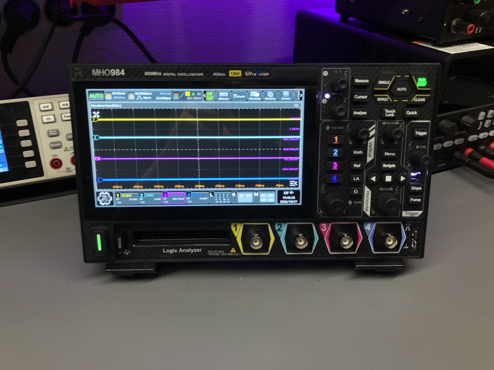
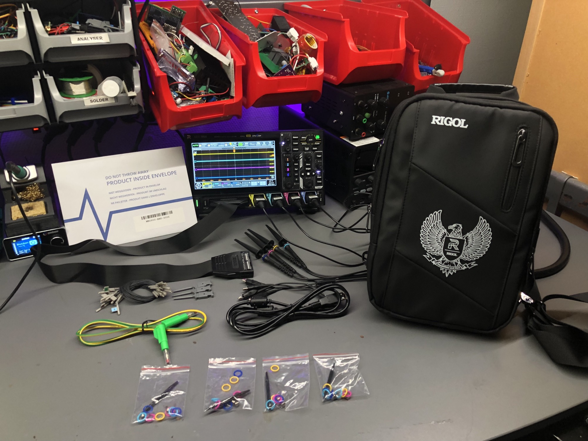
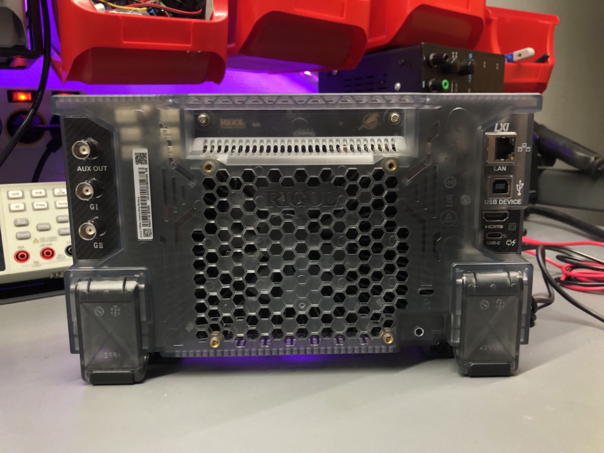
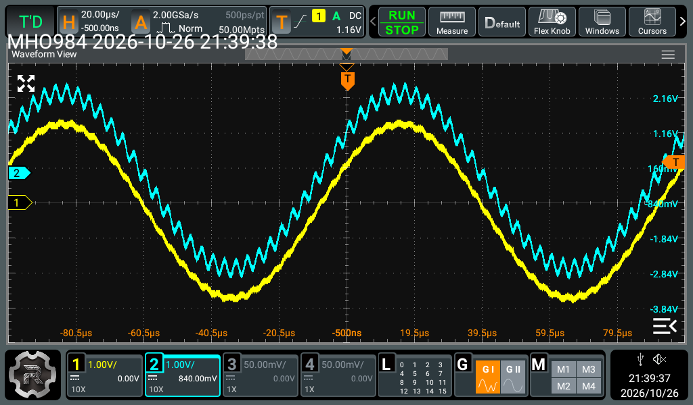
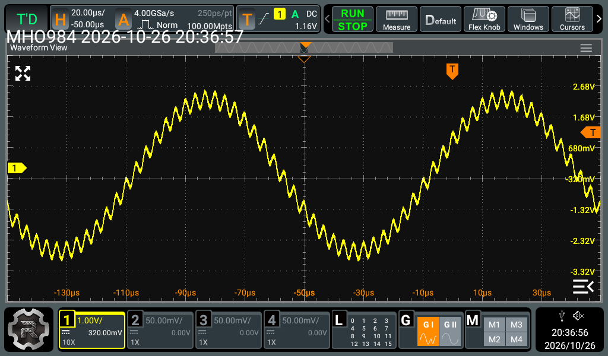
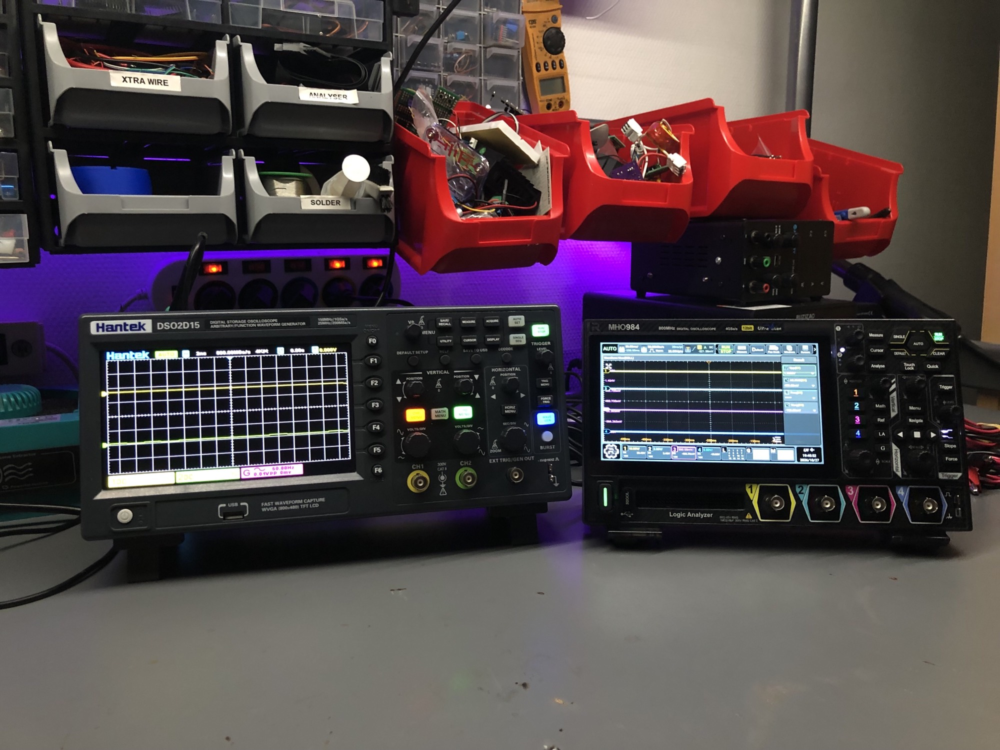
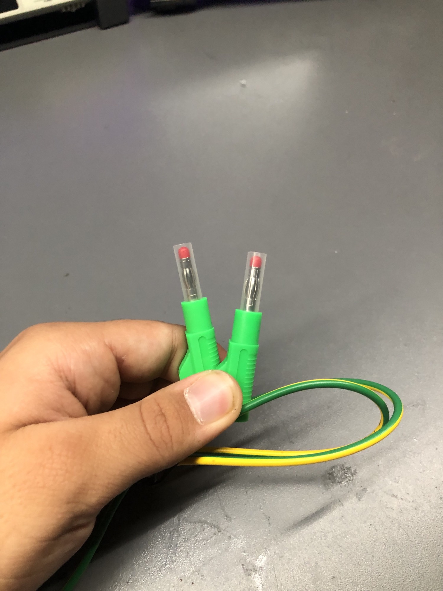

# 🔬 Rigol MHO984 — An Honest Bench Review

> **🤝 Collaboration commerciale / Commercial collaboration**
> This review is made in collaboration with [Eleshop](https://eleshop.eu/rigol) (Eindhoven, NL), who sold me the MHO900-BND bundle with a 20% discount and free shipping. Eleshop has no say on the measurements or the conclusions. Raw data and scripts are on [GitHub](https://github.com/jenatton-Malik/rigol-mho984-review).



## 📐 Why I needed a new scope

For a year and a half, my only scope was a Hantek DSO2D15: 150 MHz, 2 channels, 8 bits, 8 Mpts, bought for €230. It taught me a lot, but my projects outgrew it:

- **2 channels** — I could not watch several motor axes of my robotic arm's control board at the same time.
- **8 bits and noise** — small analog signals were unreliable, which is a problem when repairing boards.
- **Memory** — 8 Mpts on paper, but the scope lags so much at full depth that I kept it at 4 kpts most of the time.

The Rigol MHO984 promises 4 channels, 12-bit ADCs, 800 MHz in 50 Ω and 100 Mpts. This review checks what that actually changes on a real bench.

## 📦 What's in the box



The MHO900-BND bundle includes:

- The **MHO984** itself
- **4 × RP3500A** passive probes (500 MHz), each with its compensation tool, 2 spring ground clips for high-frequency measurements, and coloured rings
- The **PLA2216** 16-channel logic probe, with flying leads and mini grabbers for SMD pins
- A **Rigol carrying bag**
- A **USB-A to USB-B cable** (for remote control over USB)
- A **ground cable**
- A **100 W USB-C Power Delivery power supply**
- A **Wi-Fi dongle**, already plugged into one of the scope's USB ports



Options included in the bundle: AFG (2-channel 100 MHz generator with Bode plot), PLA2216 logic analyser, and the CAN FD, FlexRay, MIL-STD-1553 and audio bus decoders. Only the 500 Mpts memory option is not included.

### 🔑 Activating the options

The options are not pre-installed. They come in a separate envelope marked *"Do not throw away — Product is inside the envelope"* (MHO900-BND-0006). Good advice: it would be very easy to throw it away with the packaging.

Inside is a **Software License Certificate** with the series (MHO900), the option (`Bundle Option#MHO900-BND#F`) and a key. Activation takes a few steps:

1. Read the scope's serial number in **Utility → Setup**.
2. On Rigol's website, in the **License Activation** page, enter the key and the serial number. **Double-check the serial number**: the licence is bound to it.
3. Download the `.lic` file containing the activation code.
4. Install it over the network with one SCPI command. This is the only method I found:
   ```
   :SYSTem:OPTion:INSTall <option_name>@<code>
   ```

All options were active immediately. It works, but it is a technical process for a €1,000+ instrument: someone who has never sent an SCPI command could easily get lost.

## 🖐️ First hands-on

I spent my first afternoon just playing with it, without measuring anything for this review: 4 channels, deep memory, AFG, Bode plot, FFT, logic analyser on UART, near-field probes on the 50 Ω input, very small signals, an audio amplifier, an LC filter on a breadboard. Everything in this section is an impression. The numbers come later, measured under a written protocol.

Before that, I let it warm up for about an hour, ran the self-calibration and compensated the probes.

### 👍 What I liked

- **Fluidity.** The display and the touchscreen are very responsive, even with deep memory. <!-- TODO: link to side-by-side video -->
- **100 Mpts that I can actually use.** Coming from a scope that lags at 8 Mpts, this is the biggest change in daily use.
- **The AFG.** Two channels, 16 bits, 1 GSa/s. It is in another league compared with the Hantek's built-in generator. As a first test, I loaded a 16-bit arbitrary waveform from a CSV: a 5 Vpp 10 kHz sine plus a 0.5 Vpp 300 kHz sine. Then I sent it through an LC low-pass filter on a breadboard (100 µH, 110 nF, resonance ≈ 48 kHz): the 300 kHz component disappears and only the 10 kHz sine is left.

  | Two-tone arbitrary waveform | After the LC low-pass filter |
  |---|---|
  |  |  |
- **The interface.** Intuitive: I found most functions without opening the manual.
- **The form factor.** Compact, ergonomic and well built. I like compact bench tools, and this one takes little space for a 4-channel scope.

- **Firmware updates.** Once on Wi-Fi, *Upgrade* in the menu updated it online in about a minute.



Side by side with the Hantek, the difference is huge. To be fair, it is also about five times the price: the real question is what that money buys, and the measurements below try to answer it.

### 👎 What I didn't like

- **Fan noise.** A constant, slightly unpleasant fan noise. <!-- TODO: XX dB(A) at 50 cm, ambient XX dB(A), phone app — indicative only -->
- **No protective earth.** The scope is powered over USB-C, so its chassis is not earthed. A ground cable is supplied, but it is male-to-male, and French wall sockets have a male earth pin: it cannot be plugged in. This is a design choice for compactness, but it matters for safety and possibly for noise (tested later in this review).

  

- **Wi-Fi setup.** The on-screen keyboard would not let me enter my long Wi-Fi password, so I created a guest network with a shorter one.
- **Long boot time.** 58 s from power button to a usable scope, against 15 s for the Hantek.

The logic analyser deserves a word: it took me some time, but only because I had never used one integrated in a scope. Once learnt, it works like the rest of the interface.
- **Probe ratio back to ×1 after a restart.** With ×10 probes, this makes every reading wrong by a factor of 10. It is only a default setting (Utility → Setup → power-on: *Load Last*), but it is easy to miss and it caught me several times.

### ⏱️ Small facts

| | |
|---|---|
| Boot time | 58 s (Hantek DSO2D15: 15 s) |
| Firmware used for this review | 00.01.00 (updated online at reception) |

## 📏 Characterising the instrument
🚧 Coming soon — noise floor, DC gain accuracy, Bode plot validation.

## ⚖️ 12-bit vs 8-bit
🚧 Coming soon.

## ⏱️ Rise time and bandwidth
🚧 Coming soon.

## 🔌 On my own boards
🚧 Coming soon.

## 📡 Near-field EMI
🚧 Coming soon.

## 🚧 Limits of this review
🚧 Coming soon.

## 🧾 Verdict
🚧 Coming soon.
